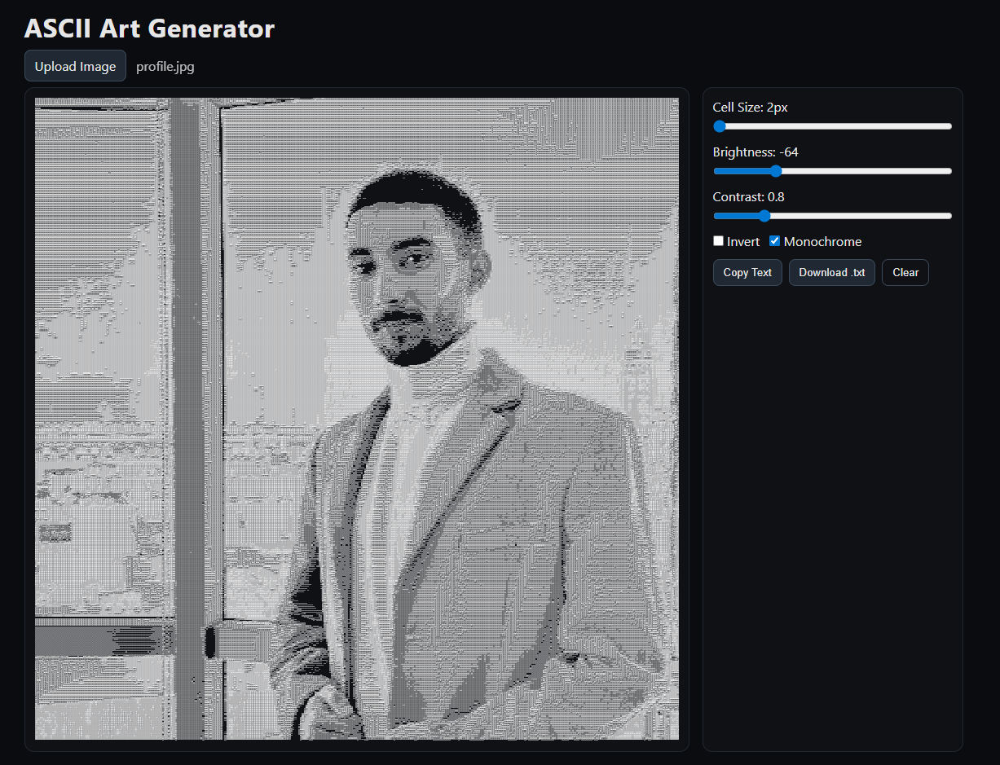

# Image To ASCII Art Converter

Converts images into ASCII art. Upload an image, tweak the cell size and contrast controls, and copy or download the generated ASCII text.

Live demo: [Image To ASCII Art Converter](https://taher-el-mehdi.github.io/image-to-ascii/)

## Usage
1. Upload an image using the Upload button.
2. Tune controls in the sidebar:
   - Cell Size: granularity of ASCII blocks (2–20 px).
   - Brightness: shift grayscale lighter/darker (-128 to 128).
   - Contrast: stretch/compress grayscale (0.5–2.0).
   - Invert: invert grayscale mapping for dark/light images.
   - Monochrome: draw ASCII in white; uncheck to colorize the canvas.
3. Preview updates live in the canvas; text appears under "ASCII Text Preview".
4. Copy or Download the text output.

## Notes

- No build step needed; pure HTML/CSS/JS.
- All processing happens client-side; no data is uploaded to a server.
